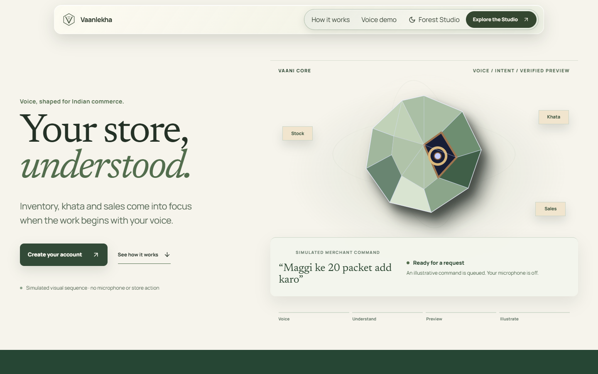
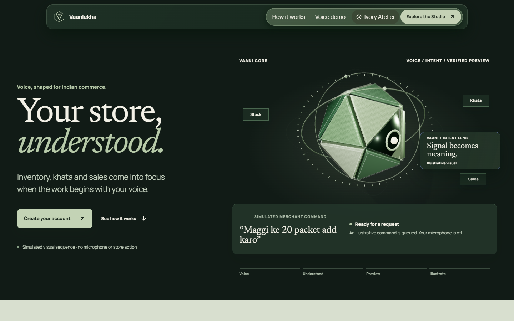
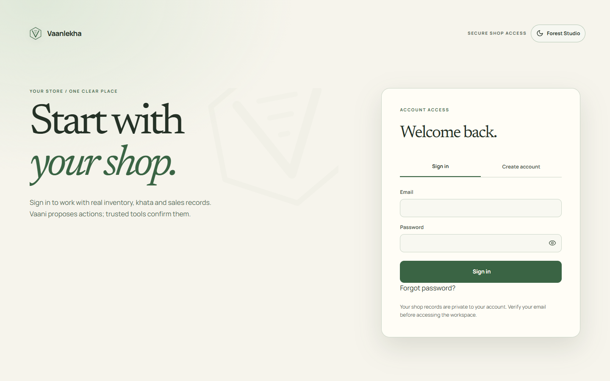
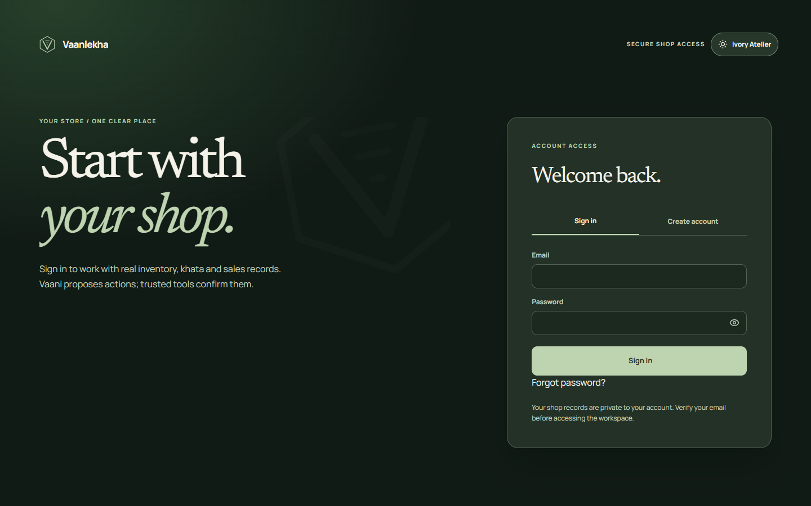
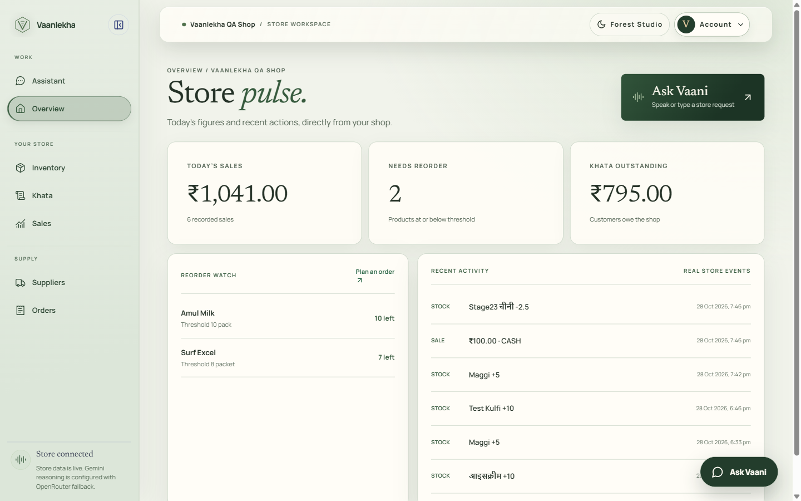
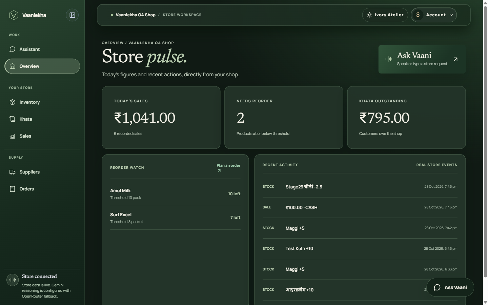
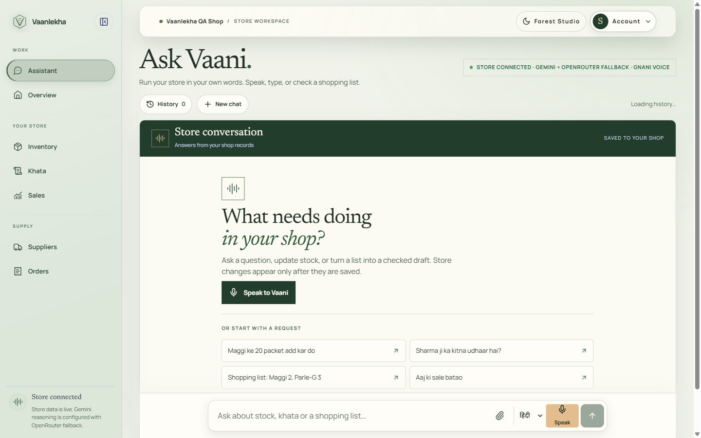
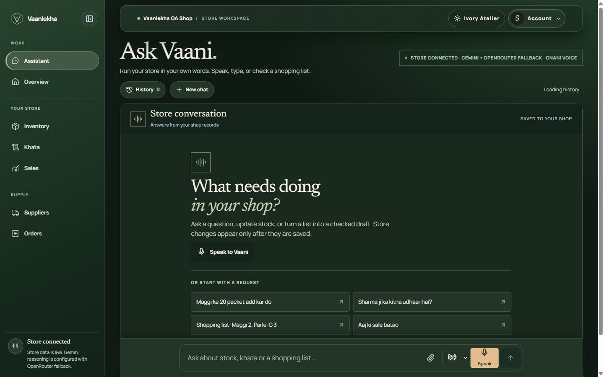

# Vaanlekha

**A voice-first shop workspace for Indian retailers.** Vaanlekha brings inventory, sales, customer khata, suppliers, and purchase orders together, with an assistant that understands Hindi, Hinglish, and English.

## Features

- Track stock, sales, customer balances, suppliers, and purchase orders in one private workspace.
- Ask Vaani questions or propose shop updates in everyday language. Sensitive changes require confirmation and are validated against saved records.
- Use voice input, text-to-speech, and shopping-list image or PDF extraction with optional server-side AI providers.
- Draft customer reminders and receipts for WhatsApp. Messages are not sent automatically.

## Architecture

The Next.js App Router serves the website and API routes. Supabase provides authentication, PostgreSQL, row-level security, and private logo storage. Gemini and OpenRouter provide optional reasoning and vision; Gnani provides optional speech services. Provider secrets remain server-side. See [architecture](docs/architecture.md) and [design](DESIGN.md).

## Run locally

1. Install Node.js 20.9 or newer and run `npm ci`.
2. Copy `.env.example` to `.env.local` and set the Supabase project URL and public key.
3. Apply [`supabase/migrations`](supabase/migrations) in order to a new project. Do not reapply migrations already recorded by an existing project. Use an existing verified Supabase account to sign in.
4. Run `npm run dev` and open [http://localhost:3100](http://localhost:3100).

`.env.example` documents the full environment. `AI_PROVIDER=mock` and `AI_REASONER=mock` are safe defaults; configure the relevant provider and server-side key to enable live AI services. Never commit `.env.local` or expose provider keys with a `NEXT_PUBLIC_` prefix.

## Deployment

Vercel hosts the Next.js frontend and API routes; Supabase remains the backend for Auth, data, and storage. Import this repository as a Next.js project, add the required environment variables in Vercel, and add the assigned site origin and `/auth/callback` to Supabase Auth’s URL settings. The app only grants workspace access to verified users.

## Verification

Run `npm run lint`, `npm run typecheck`, `npm test`, and `npm run build`. The tests include database migration, ownership, and business-transaction checks using local PostgreSQL emulation.

## Workspace screenshots

These Chrome screenshots use synthetic QA records. Ivory Atelier and Forest Studio are the two saved appearance themes.

| Screen | Ivory Atelier | Forest Studio |
| --- | --- | --- |
| Landing |  |  |
| Authentication |  |  |
| Dashboard |  |  |
| Assistant |  |  |

The [assistant history](docs/screenshots/assistant-history-ivory.png), [inventory](docs/screenshots/inventory-ivory.png), [khata](docs/screenshots/khata-ivory.png), [sales](docs/screenshots/sales-ivory.png), [suppliers](docs/screenshots/suppliers-ivory.png), [orders](docs/screenshots/orders-ivory.png), [profile](docs/screenshots/profile-ivory.png), and [mobile dashboard](docs/screenshots/dashboard-mobile-ivory.png) show the remaining views.
