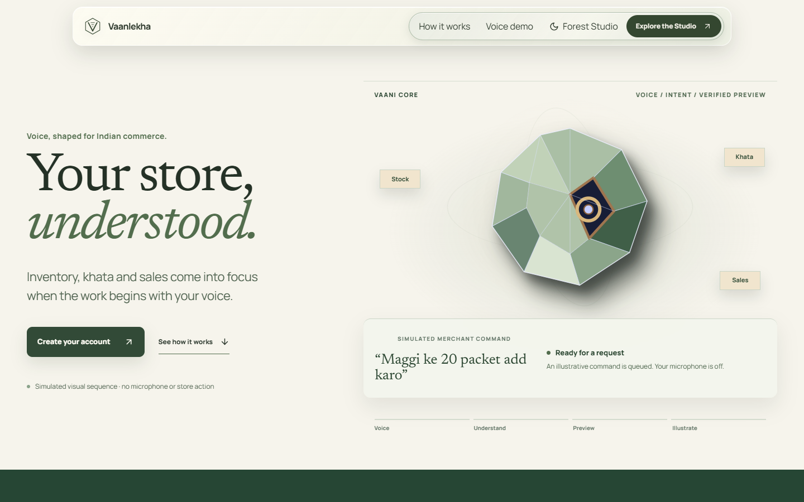
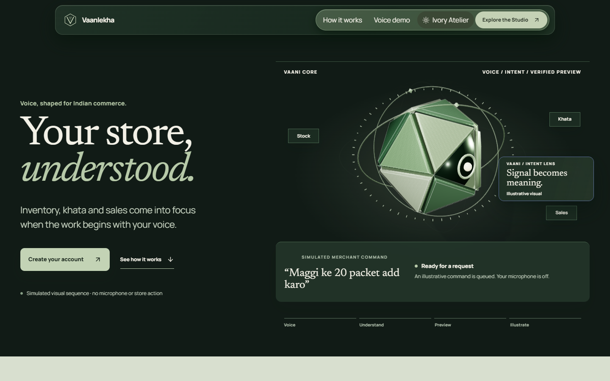
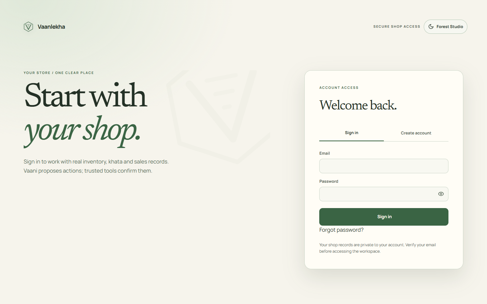
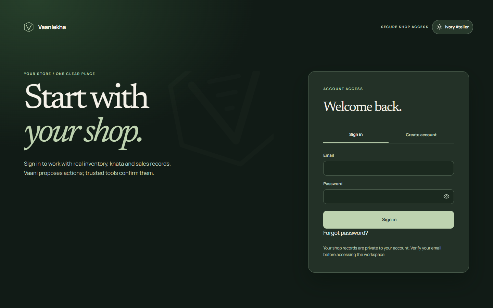
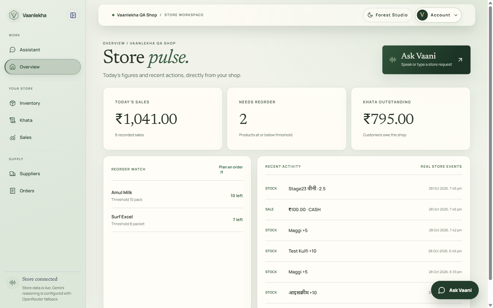
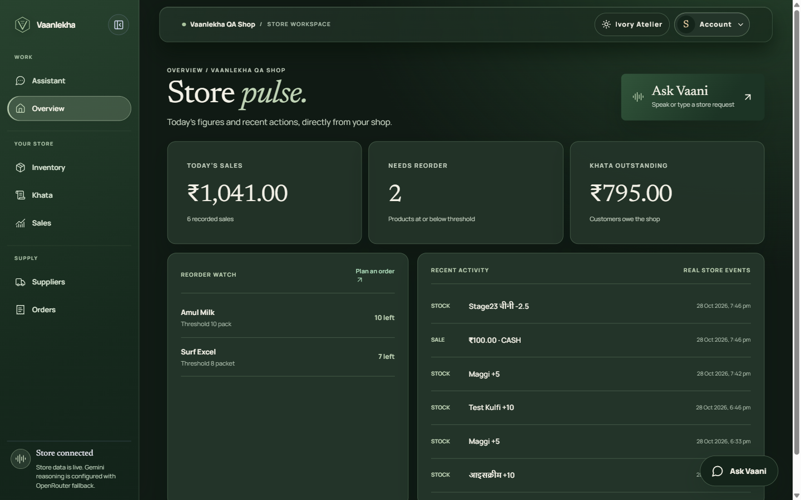
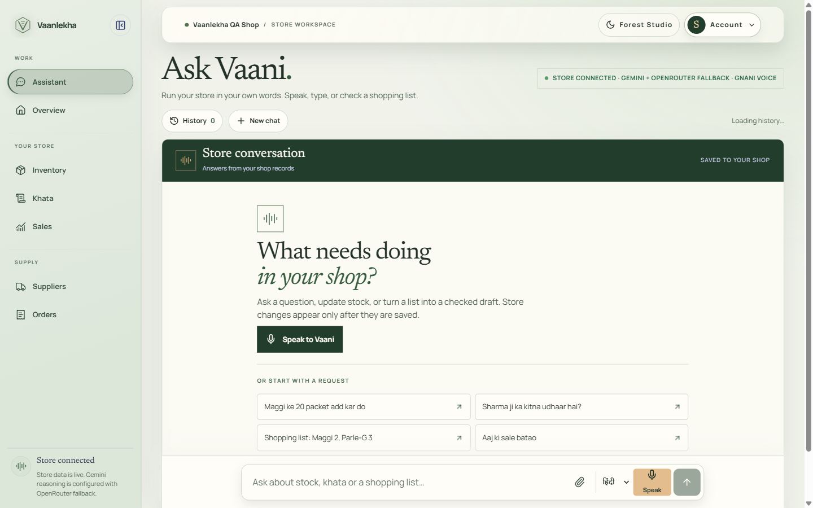
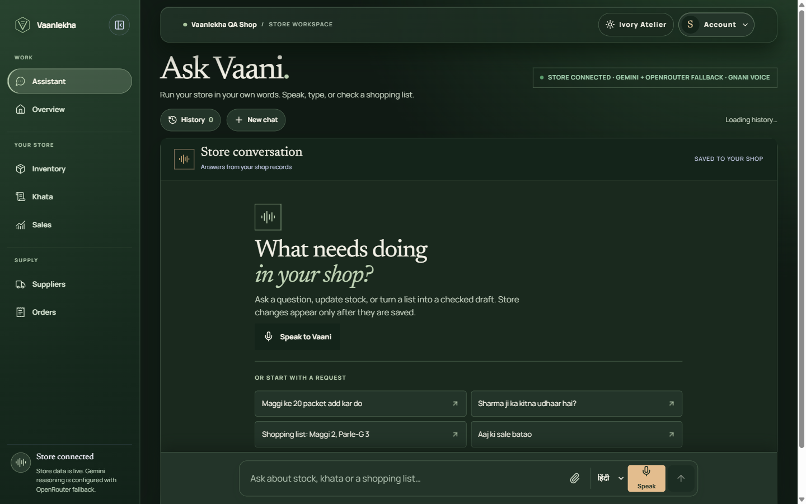

# Vaanlekha

Vaanlekha is a voice-first store workspace for Indian kirana shops and small retailers. It brings stock, sales, khata, suppliers and purchase orders into one place, with an assistant that understands everyday Hindi, Hinglish and English requests. The project was built for the Gnani AI internship competition.

## The problem

Store records often live across paper notebooks, memory and messaging apps. This makes it hard to know what is in stock, what customers owe and which orders need attention. Vaanlekha keeps those records in a private shop workspace and lets the owner ask for or propose changes in familiar language.

## What works

- Email and password authentication, a shop profile, private shop logo storage and owner-scoped records.
- Inventory with fractional quantities and units, sales and receipts, customer khata with payments, suppliers and purchase orders.
- Low-stock suggestions, WhatsApp message drafts for receipts and khata reminders, and private sale-linked customer feedback. WhatsApp drafts open in WhatsApp; the app does not send messages or confirm delivery.
- An assistant with saved conversations, confirmation before sensitive changes, deterministic parsing for common commands, Gemini reasoning with OpenRouter fallback, and optional Gnani Prisma speech-to-text and Timbre text-to-speech.
- Shopping-list image and PDF extraction through an optional OpenRouter vision model. Extracted items must be checked before a sale is recorded.

The landing-page audio examples are explicitly previews. They do not alter shop data. Supplier orders are internal records; placing one does not contact a supplier.

## Architecture

Next.js App Router serves the interface and authenticated API routes. Supabase Auth manages sessions and email verification. PostgreSQL tables and row-level security isolate shops; server-side business functions validate and apply stock, sale and khata changes. Supabase Storage holds private shop logos. The assistant first parses common commands locally, then uses Gemini or OpenRouter for harder requests. Model output is validated and grounded before trusted server tools can act. Voice and image providers are optional server-side integrations. See [architecture and trust rules](docs/architecture.md) and [visual guidance](DESIGN.md).

**Stack:** Next.js, React, TypeScript, Supabase Auth/PostgreSQL/Storage, Zod, Vitest and Playwright Chrome. The default local mode uses mock AI providers.

## Local installation

1. Install Node.js 20.9 or newer and run `npm ci`.
2. Copy [`.env.example`](.env.example) to `.env.local` and fill in the Supabase project URL and public key. Keep provider keys server-side; do not commit `.env.local`.
3. Apply the SQL files in [`supabase/migrations`](supabase/migrations) in filename order to a new Supabase project. Do not replay migrations already recorded in an existing project. Enable email confirmation, secure email change and secure password change in Supabase Auth. Set the local site URL to `http://localhost:3100` and allow `http://localhost:3100/auth/callback` as a redirect.
4. Run `npm run dev` and open [http://localhost:3100](http://localhost:3100). Create an account, verify its email, sign in and create a shop. For a production preview, run `npm run build` followed by `npm run start`; the port stays 3100.

### Environment variable names

| Purpose | Variables |
| --- | --- |
| Supabase | `NEXT_PUBLIC_SUPABASE_URL`, `NEXT_PUBLIC_SUPABASE_ANON_KEY` |
| Assistant reasoning | `AI_REASONER`, `GEMINI_MODEL`, `GEMINI_API_KEY`, `OPENROUTER_MODEL`, `OPENROUTER_API_KEY` |
| Vision | `OPENROUTER_VISION_MODEL`, `OPENROUTER_VISION_FALLBACK_MODELS` |
| Voice | `AI_PROVIDER`, `GNANI_API_KEY` |
| Public canonical URL | `NEXT_PUBLIC_SITE_URL` |

Use `AI_PROVIDER=mock` and `AI_REASONER=mock` for offline development. Real provider requests may consume quota. The configured Gemini model is `gemini-3.5-flash-lite`; OpenRouter is a bounded fallback. [Reasoner measurements](docs/reasoner-benchmark.md) describe the tested model behavior.

## Workspace screenshots

These screenshots were captured in Chrome from a synthetic QA shop. Ivory Atelier and Forest Studio are the two saved appearance themes.

| Screen | Ivory Atelier | Forest Studio |
| --- | --- | --- |
| Landing |  |  |
| Authentication |  |  |
| Dashboard |  |  |
| Assistant |  |  |

The [assistant history](docs/screenshots/assistant-history-ivory.png), [inventory](docs/screenshots/inventory-ivory.png), [khata](docs/screenshots/khata-ivory.png), [sales](docs/screenshots/sales-ivory.png), [suppliers](docs/screenshots/suppliers-ivory.png), [orders](docs/screenshots/orders-ivory.png), [profile overlay](docs/screenshots/profile-ivory.png) and [mobile dashboard](docs/screenshots/dashboard-mobile-ivory.png) show the remaining workspace screens.

## Checks and launch limits

Run `npm run lint`, `npm run typecheck`, `npm test` and `npm run build` before a release. Tests include isolated PostgreSQL checks for migrations, RLS and business transactions. Live provider and email delivery checks require configured external services.

Production email confirmation and password recovery require a configured SMTP provider, verified sender and production Auth URL allowlist. Supabase's default email service is not suitable for public signup. A production hostname and its authentication redirect must be configured before launch. Free-tier AI providers can be slow, rate limited or unavailable; the assistant does not claim an action succeeded until the database confirms it. No payment gateway, automatic WhatsApp delivery or supplier messaging is integrated.
